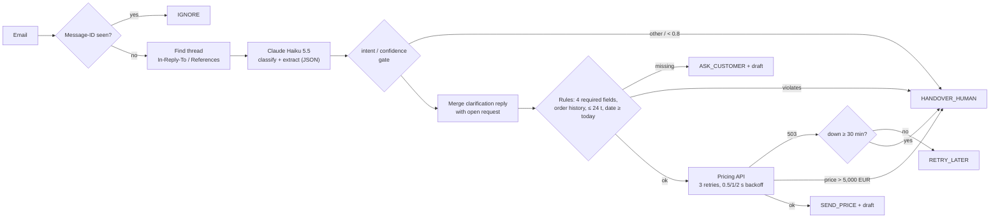

# LKW WALTER – email price requests (prototype)

An **AI workflow, not an autonomous agent**, that reads customer emails, pulls out the
transport requests and decides what happens next:

| Decision | When |
|---|---|
| `SEND_PRICE` | every request has from / to / pick-up date / weight, all checks pass, the pricing API answered → a quote draft in the customer's language |
| `ASK_CUSTOMER` | something is missing or vague ("next week") → a draft that asks for exactly the missing fields; the thread stays open |
| `HANDOVER_HUMAN` | not a price request · confidence < 0.8 · "same route as last time" with no order history · weight > 24 t · pick-up date in the past · price > 5,000 EUR · pricing API rejects the request (e.g. unknown city) · pricing API down for ≥ 30 min · LLM call failed |
| `IGNORE` | duplicate delivery (same `Message-ID`) |
| `RETRY_LATER` | pricing API still failing after 3 retries with backoff; the email is parked and retried |

**Deliverables for the case study:** [deliverables/case_study.pdf](deliverables/case_study.pdf) (answers to tasks 1–3),
[deliverables/sample_results.json](deliverables/sample_results.json) (full output for the 7 sample emails, Claude Haiku),
[deliverables/pricing_outage.json](deliverables/pricing_outage.json) (pricing API down: retry, then handover after 30 min),
[reports/accuracy.md](reports/accuracy.md) (200 synthetic emails: 99.5 % correct decisions).

**Principle: the LLM understands, rules decide.** Claude (Haiku 5.5, structured JSON output)
only classifies the email and extracts fields. Every decision is plain, tested Python in
[app/rules.py](app/rules.py) and [app/pipeline.py](app/pipeline.py). Prices in reply drafts come
from the pricing API and are filled into templates, never written by the model.



## Run it

```bash
cp .env.example .env        # optional: put ANTHROPIC_API_KEY in here
```

```bash
docker compose up --build
```

| Service | URL |
|---|---|
| Streamlit UI | http://localhost:8501 |
| Workflow API (FastAPI, `/docs`) | http://localhost:8000/docs |
| Mock pricing API | http://localhost:8001/docs |

**With or without an API key.** With `ANTHROPIC_API_KEY` set, every email is read by Claude
(`claude-haiku-5-5`). Without one, the workflow replays recorded extractions for the 7 sample
emails ([data/fixture_extractions.json](data/fixture_extractions.json)), so the demo and CI run
offline. Any other email then goes to a human. `GET /health` shows which extractor is active.

**Business date.** The case-study emails ask for pick-ups in mid-October, so compose pins the
business "today" to `APP_TODAY=2026-10-07`. Without that, every sample would be handed over as
"date in the past". Set `APP_TODAY=` (empty) to use the real date.

## Demo script (≈ 5 min)

1. Open the UI and click **Load the 7 sample emails**. Expected inbox:

   | Email | Decision | Why |
   |---|---|---|
   | E1 Linz → Antwerpen, 14.10., 24 t | 🟢 SEND_PRICE | complete; 24 t is the limit, not over it; German draft |
   | E1 again (same Message-ID) | ⚪ IGNORE | duplicate delivery, not reprocessed |
   | E2 Hamburg – Milan "next week" | 🟡 ASK_CUSTOMER | no concrete date, no weight; English draft asks for both |
   | E3 "Pick-up on 20.10., 12 t." (reply to E2) | 🟢 SEND_PRICE | merged with E2's open request in the same thread |
   | E4 Graz → Lyon + Graz → Paris | 🟢 SEND_PRICE | two requests, two prices in one draft |
   | E5 invoice 4711 | 🔴 HANDOVER_HUMAN | not a price request |
   | E6 "Gleiche Strecke wie letztes Mal" | 🔴 HANDOVER_HUMAN | reference to a previous order, no order history |

2. Open any row to see the reasons, the extracted JSON and the reply draft.
3. **API outage:** in the sidebar click **Reset database**, turn on **Simulate pricing API
   outage**, then load the samples again. E1, E3 and E4 become 🟠 RETRY_LATER (each after 4
   attempts, about 3.5 s). Set "minutes passed" to 31 and click **Retry pending**: they go to
   🔴 HANDOVER_HUMAN ("pricing API down for 31 min"). Turn the outage off and retry with 0 minutes
   instead to see them recover to SEND_PRICE.
4. **Order history:** add a past order for `einkauf@alpina.at` (Linz → Antwerpen) in the
   sidebar, then reset and load again (reset keeps order history). E6 now resolves the route and
   asks for date and weight. `docker compose down -v` gives a completely clean state.
5. **Metrics** tab: emails needing a person and handling minutes, before vs. after. The
   minutes per email are stated assumptions (`MANUAL_MIN_PER_EMAIL`,
   `REVIEW_MIN_PER_AUTO_EMAIL`), not measurements.
6. With a key: **New email** tab. Write any email (e.g. a French request for 30 t) and process it.

## Repository layout

```
app/
  extractor.py       Claude extraction (messages.parse + Pydantic schema) and fixture replay
  rules.py           deterministic checks: required fields, limits, merge, order-history lookup
  pipeline.py        dedupe → thread → extract → gate → validate → price → decide → persist
  pricing_client.py  1 call + 3 retries, exponential backoff, 4xx is not retried
  replies.py         reply templates de / en / fr / it / es with local number and date formats
  store.py           SQLite: emails, deliveries (inbox), threads (open requests), orders, events
  api.py             FastAPI workflow service used by the UI
  metrics.py         before/after numbers
pricing_api/main.py  mock pricing API (POST /price, configurable 503 rate via /admin/config)
ui/streamlit_app.py  operator UI
scripts/             synthetic data generator + accuracy evaluator
tests/               golden cases, rules, pricing API, evaluator, live Claude test
```

## Tests

```bash
python3.12 -m venv .venv && .venv/bin/pip install -r requirements-dev.txt
```

```bash
.venv/bin/pytest -v
```

- `tests/test_golden.py`: the 7 sample emails (E1 delivered twice) as golden cases, in
  delivery order, plus checks on merging, multi-route quotes, languages and order history.
- `tests/test_rules.py`: every handover rule, the 24 t edge, retry → handover after 30 min,
  recovery on retry, backoff timings (0.5 / 1 / 2 s), partial multi-request emails.
- `tests/test_live_claude.py`: the same golden cases with the real Claude extractor. It runs
  only when `ANTHROPIC_API_KEY` is set (locally or as a GitHub secret).

CI ([.github/workflows/ci.yml](.github/workflows/ci.yml)) runs ruff and pytest, then builds the
Docker image and smoke-tests `docker compose up` against the golden decisions.

## Synthetic evaluation (optional)

Labels come from construction, not from the model: [scripts/synthetic.py](scripts/synthetic.py)
samples ~200 scenarios (complete, multi-route, missing weight, vague date, missing destination,
overweight, past date, over-limit price, "same as last time", non-price topics) in five
languages. Claude then only writes an email that matches each spec.

```bash
.venv/bin/python -m scripts.generate_synthetic --n 200       # Claude Opus 5.5 writes the emails
```

```bash
.venv/bin/python -m scripts.evaluate                          # Haiku 5.5 extraction → reports/accuracy.md
```

The report contains decision, intent and per-field accuracy, a confusion matrix, accuracy by
scenario and language, and the error list. It counts separately the errors that would have
auto-sent a price wrongly, which is the expensive kind of error. `--extractor oracle` feeds
ground truth into the pipeline to check the rules alone; this runs in the test suite and must
score 100 %.

## Configuration

| Variable | Default | Meaning |
|---|---|---|
| `ANTHROPIC_API_KEY` | – | turns on Claude extraction |
| `EXTRACTOR` | `auto` | `auto` / `claude` / `fixture` |
| `EXTRACTION_MODEL` | `claude-haiku-5-5` | extraction model |
| `MIN_CONFIDENCE` | `0.8` | below this → human |
| `MAX_WEIGHT_KG` | `24000` | above this → human |
| `MAX_AUTO_PRICE_EUR` | `5000` | above this → human |
| `PRICING_DOWN_HANDOVER_MIN` | `30` | pricing outage → human after this many minutes |
| `PRICING_RETRIES` / `PRICING_BACKOFF_S` | `3` / `0.5` | retries after the first call; backoff doubles |
| `APP_TODAY` | real date (compose: `2026-10-07`) | business date for the past-date rule |
| `FAILURE_RATE` (pricing API) | `0.0` | share of requests that get a 503 |

## Prototype shortcuts

- **Ingest** is an HTTP endpoint. In production a mailbox poller (Microsoft Graph / IMAP) or
  SES inbound → SQS would call the same pipeline.
- **Drafts are not sent.** Everything stops at a draft. Auto-send for `SEND_PRICE` would be
  turned on per customer once measured accuracy allows it.
- **Retries** are triggered from the UI / `POST /retry`. In production a scheduler runs them
  every few minutes.
- **SQLite** with one writer. Production would use Postgres (RDS).
- **Thread matching** uses `In-Reply-To` / `References` only, with no subject or sender fallback.
- The pricing mock estimates road distance from coordinates of ~60 European cities and rejects
  any other city (400 `unknown_location`), which sends the email to a person. It never guesses a
  price. Claude is asked for English city names ("Mailand" → "Milan"), so reply drafts use them too.

## Deploying on AWS

- **Compute: ECS Fargate.** One image, three services: workflow API, UI (behind an ALB with SSO
  / Cognito, internal only) and, in test environments, the pricing mock. In production the
  workflow calls the real pricing service. Mail intake is an SQS consumer task that scales on
  queue depth. A scheduled ECS task (EventBridge, every 5 min) runs the `RETRY_LATER` queue.
- **State:** RDS Postgres instead of SQLite; raw emails in S3 (encrypted, with a lifecycle
  policy, since they contain personal data).
- **Secrets: AWS Secrets Manager** for `ANTHROPIC_API_KEY`, DB credentials and the pricing-API
  token, injected into the task definition as `secrets`. Nothing sensitive lives in the image or
  in plain environment variables. IAM task roles give least privilege.
- **Observability: CloudWatch.** Structured JSON logs (message id, thread id, decision, reasons,
  latency; no email bodies). Metrics: decisions per type, automation rate, handover reasons,
  pricing-API error rate and retry count, LLM latency and token cost. Alarms: pricing API in
  RETRY_LATER for > 10 min, handover rate spike, extraction failure rate, DLQ depth.
- **Delivery:** GitHub Actions builds the image, pushes it to ECR and updates the ECS service
  (rolling update with a circuit breaker). The live Claude golden test and the synthetic
  accuracy report gate changes to the prompt or model.
